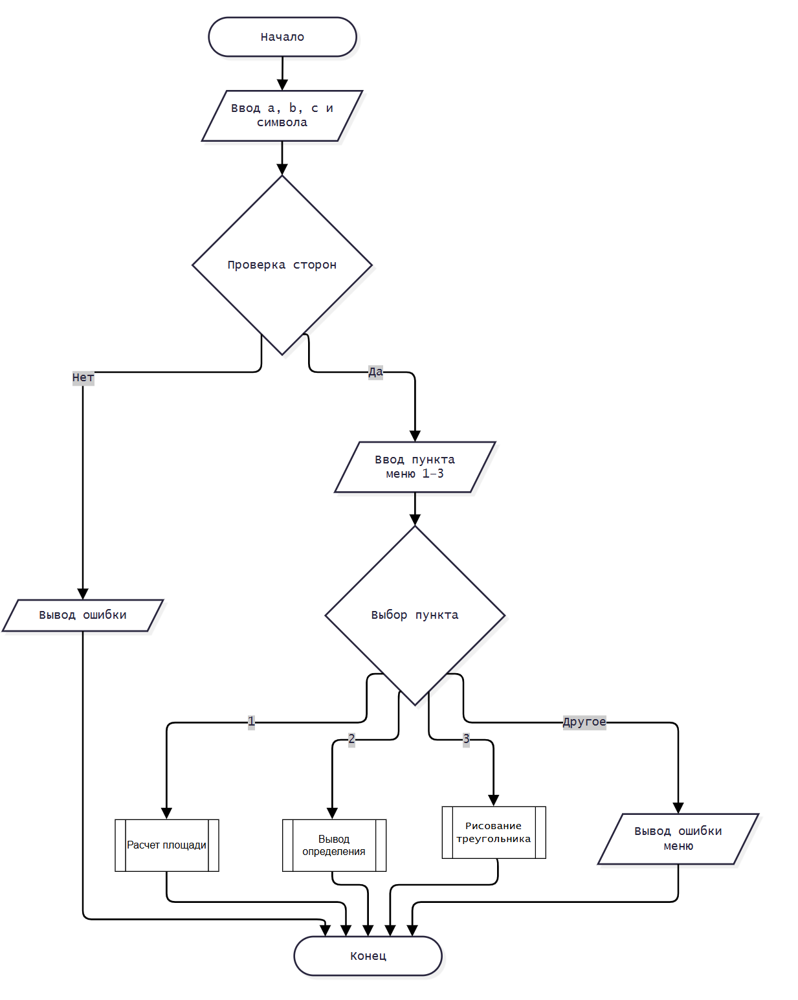

# Домашнее задание к работе 10

## Условие задачи
Составьте программу, которая для заданной пользователем фигуры, например прямоугольника (треугольника или другой фигуры см. инидивидуальное задание работы 9) предлагает меню выбора одной из операций:
1) рассчитать площадь;
2) вывести определение фигуры;
3) нарисовать фигуру.

## 1. Алгоритм и блок-схема

### Алгоритм
## Алгоритм Задания №3 (Треугольник)

Программа работает с треугольником по трем сторонам ($a$, $b$, $c$). Сторона $a$ лежит в основании.

### 1. Расчет параметров
Перед работой программа проверяет, существует ли треугольник. Если да, вычисляются:
* **Площадь ($S$):** по формуле Герона.
* **Высота ($h$):** для определения высоты рисунка ($h = 2S / a$).
* **Смещение вершины ($x$):** чтобы узнать, куда проецируется верхний угол.
* **Масштаб:** все размеры умножаются на 3 для крупного отображения в консоли.

### 2. Структура программы
Через текстовое меню `switch-case` пользователь выбирает одно из действий:
1. Вызов `area_triangle()` — расчет и вывод площади.
2. Вызов `print_def()` — вывод текста с определением фигуры.
3. Вызов `draw_triangle()` — псевдографический рисунок контура.

### 3. Принцип рисования (`draw_triangle`)
Рисунок выводится построчно сверху вниз (от вершины к основанию):
1. **Коэффициент прогресса:** вычисляется отношение текущей строки к общей высоте.
2. **Границы сторон:** с помощью прогресса рассчитывается сдвиг левой стороны (сужается к 0) и правой стороны (расширяется к полной ширине).
3. **Строка:** программа печатает отступ из пробелов, символ левой стороны, пробелы внутри треугольника и символ правой стороны.
4. **Основание:** в самом конце отдельный цикл рисует сплошную нижнюю линию из символов.

### Блок-схема
 


## 2. Реализация программы(Лабораторная и домашняя)

```#define _CRT_SECURE_NO_DEPRECATE
#include <stdio.h>
#include <locale.h>
#include <math.h>

double fa(double x);
double fb(double x);
double sin_n(double x, int N);
double sin_eps(double x, double eps);

double area_triangle(double a, double b, double c);
void print_def(void);
void draw_triangle(double a, double b, double c, char symbol);

int main() {

	setlocale(LC_CTYPE, ".UTF-8");

	double x1;
	int variant;

	printf("Введите значение x: ");
	scanf("%lf", &x1);

	printf("--- МЕНЮ ВЫБОРА (ЗАДАНИЕ 1) ---\n");
	printf("1. Расчет значения функции fa(x)\n");
	printf("2. Расчет значения функции fb(x)\n");
	printf("3. Расчет произведения квадратов\n");
	printf("4. Расчет разности квадратов\n");
	printf("5. Расчет удвоенной суммы\n");
	printf("Выберите пункт (1-5): ");

	scanf("%d", &variant);

	switch (variant) {
	case 1:
		printf("fa(x)=%lf\n", fa(x1));
		break;
	case 2:
		printf("fb(x)=%lf\n", fb(x1));
		break;
	case 3:
		printf("fa(x)*fb(x)=%lf\n", fa(x1) * fb(x1));
		break;
	case 4:
		printf("fa(x)^2 - fb(x)^2=%lf\n", pow(fa(x1), 2) - pow(fb(x1), 2));
		break;
	case 5:
		printf("(fa(x)+fb(x))*2=%lf\n", 2 * (fa(x1) + fb(x1)));
		break;
	default:
		printf("Ошибка: неверный пункт меню!\n");
		break;
	}

	double x, eps;
	printf("\nВведите значение x (в радианах): ");
	scanf("%lf", &x);

	printf("Введите точность eps (например, 1e-6): ");
	scanf("%lf", &eps);

	double stand_sin = sin(x);

	printf("\n%-4s | %-10s | %-12s\n", "N", "sin_n", "отклонение");
	printf("------------------------------------\n");

	for (int n = 1; n <= 20; n++) {
		double cur = sin_n(x, n);
		double dev = cur - stand_sin;
		printf("%-4d | %-10.4f | %-+12.4e\n", n, cur, dev);
	}

	printf("\nРезультат через sin_eps с точностью %e: %.7f\n", eps, sin_eps(x, eps));

	double a, b, c;
	char symbol;
	int choice;

	printf("\nВведи стороны a, b, c: ");
	if (scanf("%lf %lf %lf", &a, &b, &c) != 3) {
		printf("Ошибка ввода.\n");
		return 1;
	}

	printf("Введи символ: ");
	scanf(" %c", &symbol);

	if (a <= 0 || b <= 0 || c <= 0 || a >= b + c || b >= a + c || c >= a + b) {
		printf("Треугольник с такими сторонами не существует.\n");
		return 1;
	}

	printf("\n--- МЕНЮ ВЫБОРА (ЗАДАНИЕ 3) ---\n");
	printf("1) Рассчитать площадь треугольника\n");
	printf("2) Вывести определение фигуры\n");
	printf("3) Нарисовать фигуру\n");
	printf("Выберите пункт меню (1-3): ");

	if (scanf("%d", &choice) != 1) {
		printf("Ошибка ввода пункта меню.\n");
		return 1;
	}

	switch (choice) {
	case 1:
		printf("\nПлощадь треугольника S = %.4f\n", area_triangle(a, b, c));
		break;
	case 2:
		print_def();
		break;
	case 3:
		draw_triangle(a, b, c, symbol);
		break;
	default:
		printf("Ошибка: неверный пункт меню!\n");
		break;
	}

	return 0;
}

double fa(double x) {
	return x <= 3 ? pow(x, 2) - 3 * x + 9 : 1 / (pow(x, 3) + 3);
}

double fb(double x) {
	return x * exp(sin(pow(x, 2)));
}

double sin_n(double x, int N) {
	double sum = x;
	double tekuschi = x;

	for (int k = 2; k <= N; k++) {
		tekuschi = tekuschi * (-x * x) / ((2 * k - 2) * (2 * k - 1));
		sum += tekuschi;
	}
	return sum;
}

double sin_eps(double x, double eps) {
	double sum = x;
	double tekuschi = x;
	int k = 2;

	while (fabs(tekuschi) > eps) {
		tekuschi = tekuschi * (-x * x) / ((2 * k - 2) * (2 * k - 1));
		sum += tekuschi;
		k++;
	}
	return sum;
}

double area_triangle(double a, double b, double c) {
	double pp = (a + b + c) / 2.0;
	return sqrt(pp * (pp - a) * (pp - b) * (pp - c));
}

void print_def(void) {
	printf("\n================ ОПРЕДЕЛЕНИЕ ФИГУРЫ ================\n");
	printf("Треугольник — это геометрическая фигура, состоящая из трех точек,\n");
	printf("не лежащих на одной прямой, и трех отрезков, попарно соединяющих эти точки.\n");
	printf("====================================================\n");
}

void draw_triangle(double a, double b, double c, char symbol) {
	double pp, S, h;
	double x;

	int masshtab = 3;
	int shirina, vysota;
	int kol, levo, pravo;
	int i, probel;

	pp = (a + b + c) / 2.0;
	S = sqrt(pp * (pp - a) * (pp - b) * (pp - c));
	h = 2.0 * S / a;

	x = (a * a + c * c - b * b) / (2.0 * a);

	shirina = (int)(a * masshtab + 0.5);
	vysota = (int)(h * masshtab + 0.5);

	if (shirina < 2 || vysota < 2 || shirina > 150 || vysota > 100) {
		printf("Размер не подходит для консоли при масштабе %d.\n", masshtab);
		return;
	}

	for (kol = 0; kol < vysota; kol++) {
		double progress = (double)kol / vysota;

		levo = (int)(masshtab * x * (1.0 - progress) + 0.5);
		pravo = (int)(masshtab * (x + (a - x) * progress) + 0.5);

		if (levo < 0) levo = 0;
		if (pravo > shirina) pravo = shirina;

		for (i = 0; i < levo; i++) {
			printf(" ");
		}

		printf("%c", symbol);

		probel = pravo - levo - 1;
		if (probel > 0) {
			for (i = 0; i < probel; i++) {
				printf(" ");
			}
			printf("%c", symbol);
		}
		printf("\n");
	}

	for (i = 0; i <= shirina; i++) {
		printf("%c", symbol);
	}
	printf("\n");
}
```

## 4. Информация о разработчике

Медведкин Артём Александрович группа бТИИ-262
